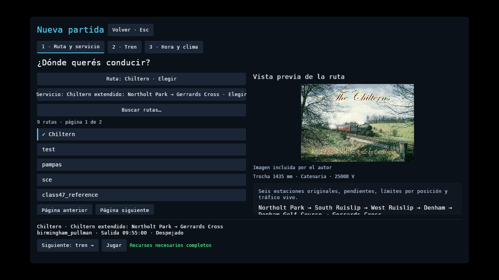
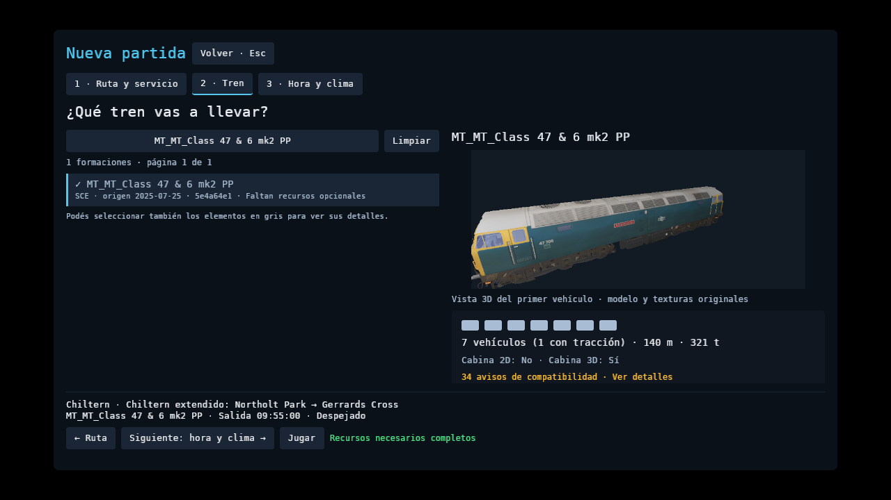

# Biblioteca, previews y diez rutas de la comunidad

Se probaron diez rutas distribuidas por Open Rails o sus autores. No se encontró
un ranking público verificable de jugadores activos: esta selección combina el
[catálogo de Open Rails](https://www.openrails.org/download/content/), su demo
recomendada y rutas con cifras de descarga publicadas por sus autores. No se
presenta como «las diez más jugadas».

`cases.json` conserva fuentes, versiones/commits, hashes y las actividades y
formaciones elegidas. `verification.json` registra auditorías, importación,
servicios y capturas, con hashes de los binarios usados y sin rutas personales.
Los archivos originales descargados, sus extracciones y los CSV de prueba
quedan fuera de Git. Las capturas son resultados del juego, no paquetes de rutas.

## Qué se comprobó

- **3.139 formaciones auditadas** en estos paquetes: 1.934 sin errores de
  recursos obligatorios; 1.805 además contienen vehículos con tracción. No
  certifica sus scripts, sistemas físicos, cabinas o compatibilidad con cada mapa.
- **Siete rutas importan y permiten circulación**: Chiltern v4, Demo Model 1,
  BNSF, LIRR, Great Zig Zag, Burrinjuck y Craven. Para cada una se capturó cabina
  al inicio y exterior tras avanzar al menos 200 m con la formación indicada.
- Las 14 capturas usan RX 7600/RADV, Vulkan y 1280 × 720, sin audio, con reloj
  ×16 y 2 km de escenario. Exigen terreno y recursos cercanos preparados,
  pipelines sin pendientes/fallos y ausencia de errores SIGSCR en ese tramo.
  La separación entre centros de coches se compara con sus offsets, con
  tolerancia de 2 m que incluye el acortamiento de cuerda en curvas. El mayor
  error observado fue **0,0068 m**. No verifica enganches en todo el recorrido.
- **Demo Model 1 completa su servicio original** de Edinburgh Waverley a
  Linlithgow con tres paradas, usando Class 47 y seis coches Mk2, sus Includes
  y cabina 3D. Se comprueba con la física y el conductor del jugador.
- `check.sh` pasa: formato, Clippy, **1.764 pruebas Rust y 89 Python**, build,
  web y los oráculos fijados en Open Rails 1.6.1. El servicio del piloto mantiene
  RMS de velocidad **0,2081 m/s** y diferencia máxima de odómetro **39,61 m**;
  Class 47 mantiene **0,2382 m/s** y **25,79 m**, dentro de sus tolerancias.

El pico RSS de las capturas nativas va de aproximadamente 618 a 2.639 MiB.
Es memoria de proceso durante carga y un tramo corto, no memoria GPU ni una
medición del viaje completo. Los tiempos incluyen la carga inicial y las
capturas en pausa; no se utilizan para afirmar una mejora de FPS.

## Resultados por contenido

- **Chiltern v4**, commit `8236df20`: 188 formaciones; 153 con recursos para
  conducción. `Test Paddington Suburban Down Daytime.act` y `Railcarx2.con`
  pasan ambas vistas y movimiento. `RS_Let's go to Birmingham.act` falla al
  resolver la plataforma 11358 de su horario; no se ocultó esa prueba.
- **Demo Model 1 / SCE**: 23 formaciones; 12 con recursos para conducción.
  Actividad `MT_MT_0930 Edinburgh-Glasgow Queen Street.act`, formación
  `MT_MT_Class 47 & 6 mk2 PP.con`. Pasa servicio completo y ambas vistas.
- **BNSF Starter Route**: 17 formaciones; una con recursos para conducción.
  `5_wb_empirebuilder.act` y `amtrak empire builder wb.con` pasan carga y 200 m.
- **LIRR**: 42 formaciones; 15 con recursos para conducción.
  `01Brooklyn-Hempstead.act` y `SFexpress-500.con` pasan ambas vistas y 200 m.
  El servicio agota sus 1.560 s originales tras 18.047,52 m, con la primera
  parada atendida; **no completa Hempstead**. `04CentralPickups.act` con su
  locomotora original no encuentra el PAT operativo entre n1267 y n1265.
- **MidEast Coast**, commit `1c47480e`: 926 formaciones; 554 con recursos para
  conducción. Importación bloqueada: `UK4LIGHTRL` usa `TRAINHASCALLON`.
- **Portugal 79**, commit `56bce749`: 1.866 formaciones; 1.053 con recursos para
  conducción. El alias `ORTSScript` IIL → II ya se resuelve. La importación sigue
  bloqueada: `AA2SDA` usa `TRAINHASCALLON`. El paquete no trae ACT para PT79.
- **Great Zig Zag 1.6**: 56 formaciones; dos con recursos para conducción.
  Se usa `tutorial#2_basic_train_control.act` con **sustitución explícita** por
  `tutorial#6_player_train.con`, del mismo paquete. Pasa carga y 200 m; no es
  la pareja original del tutorial 2. `tutorial#6_loading.act` falla por una
  cadena sin cierre; varias formaciones tienen Includes absolutos rechazados.
- **Coals to Newcastle 7(4)**: no incluye trenes; se necesitan recursos aparte.
  Importación bloqueada: `NSWCOLLIGHT-17` usa `NEXT_SIG_MR`.
- **Burrinjuck 3**: diez formaciones; seis con recursos para conducción.
  `Default.act` y `burr_jack_light.con` pasan carga y 200 m.
- **Craven Timber Railway 1(2)**: once formaciones; nueve con recursos para
  conducción. `default.act` y `CT-No1-LightEngine.con` pasan carga y 200 m.

Las actividades elegidas de BNSF, Burrinjuck, Craven, Chiltern y Zig Zag no
proporcionan una última parada terminal reconocida por `play-service`. Su error
queda registrado: **circulación corta aprobada no equivale a servicio completo**.
La comparación de horarios, PAT, Includes y esos finales se sigue en el
[issue #210](https://github.com/cavazquez/openrailsrs/issues/210).
Las funciones SIGSCR pendientes se siguen en el
[issue #209](https://github.com/cavazquez/openrailsrs/issues/209).
Ambos siguen abiertos.

Los instaladores australianos originales se extrajeron como datos, sin ejecutar
sus EXE. Las carpetas con nombres que sólo difieren en mayúsculas se unificaron
como en Windows, comprobando que no hubiera archivos distintos en un mismo
destino. No se modificaron scripts, actividades, vehículos ni texturas del autor
para hacer pasar las pruebas.

## Biblioteca y selección

Ruta, servicio y formación tienen listas con buscador, páginas y selección
directa mediante clic o teclado. Los trenes se reúnen desde los paquetes
instalados, los ejemplos y la biblioteca de material rodante. Conservan los
recursos de su propia edición incluso si el mapa elegido trae carpetas con
los mismos nombres. Los trenes de un paquete también se pueden descubrir antes
de que su mapa se haya preparado correctamente.

Los recursos faltantes aparecen en gris y **se pueden seleccionar**. El CAF
incompleto muestra sus detalles; no se puede iniciar hasta completar los
recursos obligatorios. La Class 47 de Demo Model 1 se puede elegir en Chiltern:
sus recursos opcionales faltantes la muestran en gris, conserva su preview
original y permite **Jugar**. Los avisos de trocha o alimentación son amarillos
y no bloquean por sí solos la selección o el inicio. Un aviso no implementa
una incompatibilidad física nueva; se informa con los datos declarados.

La ruta muestra la imagen de carga del autor. El tren muestra su primer vehículo
en 3D con sus texturas; el esquema y la auditoría describen la formación completa.
La carga se hace en dos trabajadores de I/O que descartan solicitudes antiguas.
Las previews limitan tamaño y cantidad de recursos y confinan las lecturas al
paquete. Su cámara y luz usan una capa aislada; se liberan al salir del selector.

Se capturaron las pantallas a 1280 × 720 y el CAF seleccionado a 640 × 480.
Las comprobaciones mantienen las acciones del pie dentro de la ventana y
rechazan texto visible colapsado. La prueba de interacción confirma la selección
de elementos grises y el funcionamiento del buscador con tildes, Enter y Esc.






## Repetir

Desde el checkout, con los paquetes originales ya instalados:

```bash
python3 scripts/check_community_routes.py \
  --content-root "$HOME/.local/share/openrailsrs/official-content" \
  --content-root "$HOME/.local/share/openrailsrs/community-route-qa/2026-10-11" \
  --out-dir tmp/community-routes-qa --gpu --service
```

Adaptá las carpetas a tu instalación. `--only chiltern demo` permite repetir
casos sin borrar los resultados de los otros. Las versiones del manifiesto son
intencionales; una copia posterior del autor necesita un caso y resultado propios.
El script devuelve error mientras existan importaciones, capturas o servicios
fallidos. No descarga contenido, no ejecuta instaladores y no desactiva señales.
Las fuentes originales están enlazadas en cada caso del manifiesto.

Para probar el menú a mano, seguí
[la selección de contenido](../../../PLAYER_MANUAL_TESTS.md#1-menú-de-inicio-y-selección-de-contenido).
Los datos de Biblioteca siguen en el directorio escribible del usuario, compatible
con Snap y binario portátil. Las carpetas `community-route-qa` son una instalación
separada para pruebas; no se añaden automáticamente al menú de otras instalaciones.
