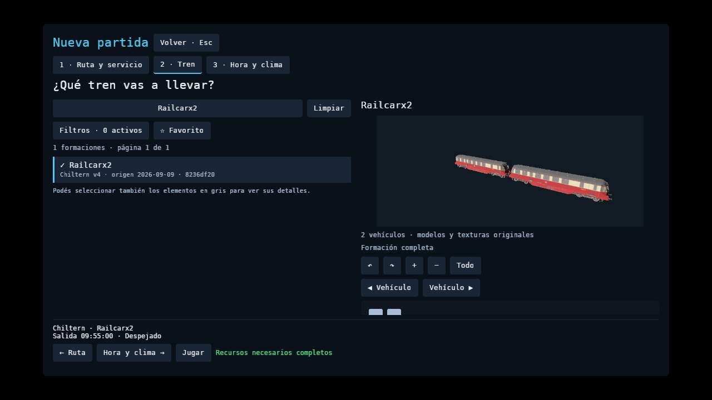
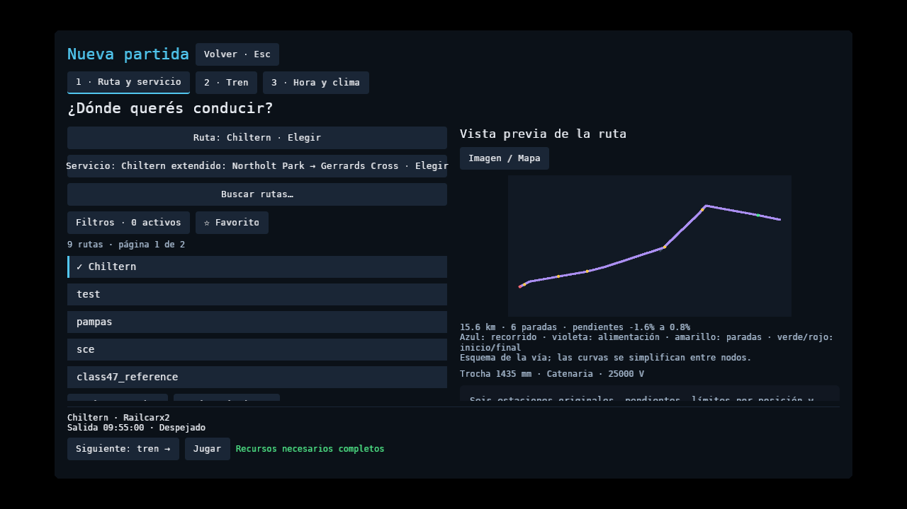
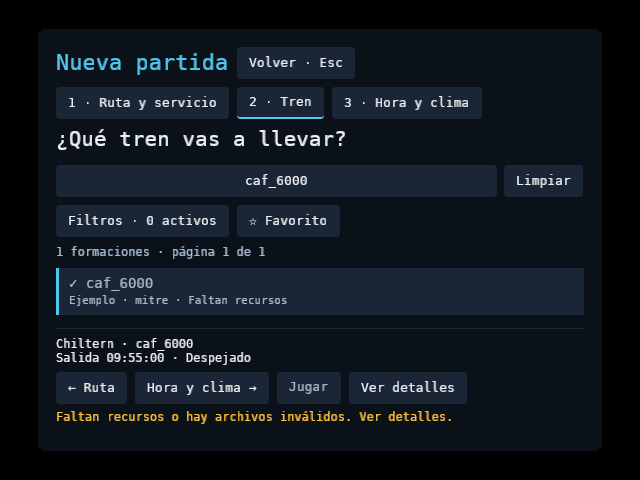
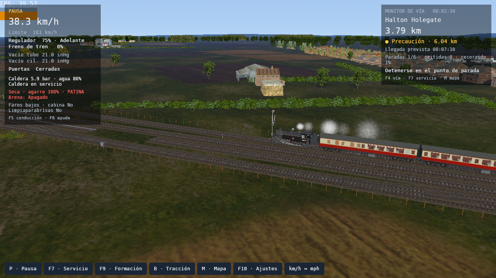
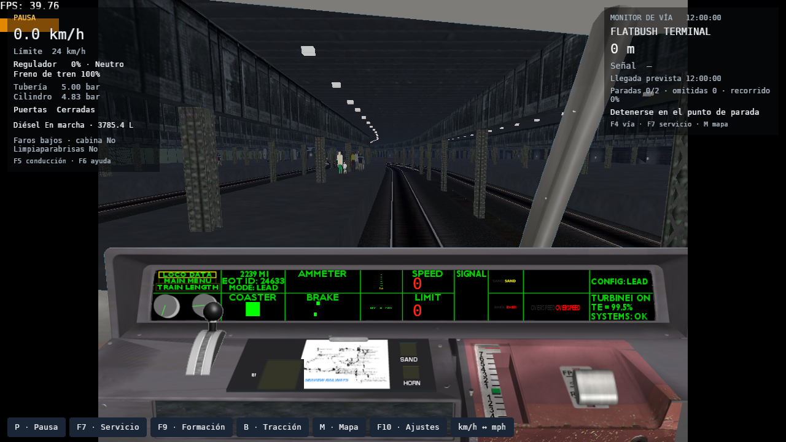

# Biblioteca, previews y diez rutas de la comunidad

Se probaron diez rutas distribuidas por Open Rails o sus autores. No se encontró
un ranking público verificable de jugadores activos: la selección combina el
[catálogo de Open Rails](https://www.openrails.org/download/content/), su demo
recomendada y rutas con cifras de descarga publicadas por sus autores. No se
presenta como «las diez más jugadas».

`cases.json` fija fuentes, ediciones, hashes, actividades y formaciones.
`verification.json` conserva resultados y hashes de los binarios. Los paquetes
originales, extracciones, ajustes personales y CSV permanecen fuera de Git y del
Snap. Las imágenes son capturas del juego.

## Alcance comprobado

- **Diez importaciones aprobadas**, conservando los SIGSCR donde el paquete los incluye.
- **3.139 formaciones auditadas**: 2.342 tienen sus recursos obligatorios y
 2.213 además contienen vehículos de tracción. Es una auditoría de recursos;
 no certifica todos sus scripts, motores, cabinas o compatibilidad con cada mapa.
- Siete itinerarios ACT seleccionados llegan a su final con la física del
 jugador. Se conservan los PAT, las paradas declaradas y las formaciones del
 autor. Los resultados incluyen retrasos; la duración del ACT es una estimación
 en OR, no un plazo que interrumpa automáticamente la partida.
- El final significa **itinerario y paradas declaradas resueltos**. No significa
 ejecución completa de todos los eventos ACT, cargas, trenes estáticos o actores
 de maniobras. Esos eventos no se marcan como aprobados por llegar al final.
- La maniobra original de LIRR recorre 21 tramos con inversiones. El horario
 original de Demo Model 1 reutiliza el mismo tren para su servicio de vuelta.
- Las tres rutas antes bloqueadas por SIGSCR tienen capturas nuevas de puesto
 de conducción y exterior después de 200 m (1 km en Coals). Se comprueban ocupación, reserva,
 call-on y aspectos en pruebas de sesión; los oráculos añaden **419 contextos
 de funciones y 256 máscaras** ejecutados contra las DLL de OR 1.6.1.
 En los grafos originales, ocupación ajena restringe 2/262/121 cabezas
 de MidEast/Portugal/Coals. Una reserva protegida mantiene Stop y liberar
 al otro tren recupera los aspectos previos. Son contextos de bloque aislados,
 además de las pruebas de circulación, no una sesión completa de tráfico OR.
- AMMETER, AMMETER_ABS y LOAD_METER tienen **48 resultados de referencia** de
 las DLL originales. Los instrumentos usan esfuerzo motor y velocidad de ejes,
 conservando la escala CVF del autor.
- El banco de `check.sh` incluye formato, Clippy, pruebas Rust/Python, build,
 web y los oráculos. El piloto mantiene RMS **0,2081 m/s** y error máximo de
 odómetro **39,61 m**; Class 47 mantiene **0,2382 m/s** y **25,79 m**.

## Resultado por ruta

- **Chiltern v4**, commit `8236df20`: 188 formaciones, 153 listas para conducir.
 La actividad de prueba Paddington Suburban llega al final de su PAT.
 `RS_Let's go to Birmingham.act` y Bristol Pullman recorren **110,194 km** y
 atienden Banbury. El ítem 11358 ya no es una plataforma de esa edición: se
 conserva la advertencia y se omite esa referencia obsoleta como hace OR.
 Banbury registra **211 s de retraso**; no se presenta como llegada puntual.
- **Demo Model 1 / SCE**: 23 formaciones, 12 listas. La actividad original
 Edinburgh–Glasgow Queen Street, con Class 47 y seis Mk2, recorre **28,216 km**
 y atiende tres paradas. El horario SCE_total encadena T_0730_SHOTTS con
 T_0800_EDBS: **6,954 km**, cuatro paradas, tres coches y la misma formación.
- **BNSF Starter Route**: 17 formaciones, una lista. Empire Builder original
 recorre **195,935 km** y atiende tres paradas.
- **LIRR**: 42 formaciones, 17 listas. Brooklyn–Hempstead con SFexpress-500
 llega al final: **31,368 km**, dos paradas y **1.603 s**. Llega a Hempstead
 con **11,2 s de retraso**, conservando el horario del autor. Los 1.560 s del ACT
 son su tiempo estimado, no un plazo de fallo. CentralPickups con 1xNECX102 completa **21 tramos**,
 **32,776 km** y las inversiones del PAT, sin teletransportar los coches.
- **MidEast Coast**, commit `1c47480e`: 926 formaciones, 556 listas. Importa
 todos los programas referenciados y circula con la locomotora 84030 y dos Mk1
 originales. Firsby–Spilsby atiende sus tres primeras paradas; **el itinerario
 completo aún falla** al empezar el rodeo de los coches por otra vía. Esa
 maniobra necesita una sección separada y control manual; no se reemplaza por
 otra ruta ni se marca el servicio como completo.
- **Portugal 79**, commit `56bce749`: 1.866 formaciones, 1.407 listas. Importa
 sus programas originales, incluido el alias ORTSScript IIL → II. Se captura el
 PAT original `lisboa-porto1` con CP5600+IC2a, seis coches. El paquete
 trae horarios para CPV_Sul, pero no un ACT de PT79; esta circulación es
 derivada del PAT, no una actividad original completa.
- **Great Zig Zag 1.6**: 56 formaciones, 52 listas. El tutorial 6 importa y
 recorre **5,373 km** con `tutorial#6_player_train.con`, su formación original.
 Se contrastaron las comillas recuperables del ACT y los Includes con el lector
 de OR. No se afirma haber ejecutado todos sus eventos de carga.
- **Coals to Newcastle 7(4)**: importa todos los programas referenciados.
 No incluye trenes. El PAT `Default.pat` se captura usando **Railcarx2 de
 Chiltern**, instalado aparte; no se atribuye esa formación al autor de Coals.
 El paquete carece de las mallas de vía GLOBAL/SHAPES; utiliza reemplazos
 procedurales. Su orientación debe seguir la base ferroviaria TDB, conservando
 curvas y offsets de los cambios; esto no certifica el aspecto de las mallas
 originales ausentes.
- **Burrinjuck 3**: diez formaciones, seis listas. `Default.act` y
 `burr_jack_light.con` llegan al final de **42,749 km**.
- **Craven Timber Railway 1(2)**: once formaciones, nueve listas.
 `default.act` y `CT-No1-LightEngine.con` llegan al final de **12,088 km**.

La captura de MidEast detectó una diferencia de 100 m entre recorrido importado
y geometría: dos TrackSection ferroviarios usaban un ShapeIndex marcado RoadShape
en GLOBAL. El recorrido visual ahora conserva todos los tramos de la base TDB;
el filtro de mallas de carretera no modifica la cadena de posiciones del tren.
En Coals, los puntos intermedios del PAT permanecen sobre su vector; únicamente
los puntos de tipo junction == 2 crean un desvío. Se verificaron seis
combinaciones de flags con las propiedades de las DLL originales.
También se conserva el archivo ENG/WAG del CON para cargar cabinas y asientos,
aunque su nombre sea distinto del modelo 3D. Una cabina sólo 2D puede abrirse
cuando no existe un interior 3D.

El contraste adicional de LIRR detectó que los carteles se asignaban al sentido
contrario del vector. La corrección reproduce el redondeo y el criterio de
`Signals.AddSpeed`. Se verifican 778 orientaciones de las DLL, 776 límites
positivos por sentido y posición, dimensiones por vehículo, 150 t, 6,526 MW,
1.301,3 kN máximos y 350 kN de freno declarado. El límite inicial ahora es
15 mph / 24,14 km/h. La longitud de cuerpos coincide; OR añade 0,6 m de holgura
de acoples. Estos parámetros no certifican toda la respuesta neumática ni una
traza física completa de esa formación.

## GPU y viaje completo con clima

Las capturas nuevas usan RX 7600/RADV, Vulkan, 1280 × 720, 2 km de escenario y
reloj ×16. Exigen terreno y objetos cercanos preparados, pipelines sin fallos,
SIGSCR sin errores y separación entre centros coherente con los offsets. La
tolerancia geométrica es 2 m e incluye la cuerda de las curvas. Las siete rutas
restantes conservan sus capturas anteriores identificadas por el hash de aquel
binario; no se presentan como capturas nuevas de esta versión.

El viaje de seis estaciones Northolt Park → Gerrards Cross se repite completo
con despejado, lluvia intensa y nieve intensa, 2.048 partículas Hanabi y ocho
coches. `verification.json` registra RSS, VRAM, percentiles de cuadro y paradas.
El reloj ×16 es **estrés acelerado**, no una medición de FPS de conducción normal.
La memoria GPU se mide por separado de la memoria del proceso. No es posible
sustituir por GPU toda la importación de archivos ni la simulación ferroviaria.

Los tres casos completan sus seis paradas dentro de ±10 m y a menos de 0,1 m/s.
Durante la conducción, P95 es **25/25/26 ms** y P99 **55/56/57 ms** para
despejado/lluvia/nieve. Hay **2/2/4 cuadros mayores a 100 ms**, con máximos
**247/244/269 ms**; esos tirones siguen registrados. RSS máximo es
**2.436/2.325/2.491 MiB** y VRAM del proceso **2.524/2.794/2.606 MiB**.
La carga inicial tiene cuadros de hasta **1,54–1,70 s** y se informa aparte.
Las cifras corresponden al binario identificado en `verification.json`.

Las capturas finales conservan el resumen y las seis paradas: [despejado](journey-clear.png),
[lluvia intensa](journey-downpour.png) y [nieve intensa](journey-heavy_snow.png).

## Biblioteca y selección

Ruta, servicio y formación tienen listas con buscador. Los filtros de país,
trocha, tracción, recursos y favoritos se despliegan sólo cuando hacen falta.
Los favoritos se conservan entre sesiones. El origen del paquete se mantiene
aunque se elija otro mapa con archivos de igual nombre.

Los recursos faltantes aparecen en gris y **se pueden seleccionar**. El CAF
incompleto muestra diagnóstico y ubicación de archivos; Jugar permanece
desactivado hasta completar los recursos obligatorios. Los avisos opcionales,
de trocha o de alimentación permiten revisar la selección sin ocultarla.
Los datos desconocidos no se presentan como compatibilidad certificada.

La ruta combina imagen original y mapa del servicio, con paradas, longitud,
pendientes y alimentación declarada. El tren presenta **toda la formación**,
conserva las inversiones y permite girar, acercar y enfocar cada vehículo.
Las previews limitan modelos, geometría y texturas; sus lecturas quedan confinadas
al paquete y utilizan una cámara aislada. A 640 × 480 queda una opción de tren
completa visible y las acciones del pie permanecen dentro de la ventana.











## Repetir

Con los paquetes originales ya instalados, desde el checkout:

```bash
python3 scripts/check_community_routes.py \
 --content-root "$HOME/.local/share/openrailsrs/official-content" \
 --content-root "$HOME/.local/share/openrailsrs/community-route-qa/2026-10-11" \
 --out-dir tmp/community-routes-qa --gpu --service
```

Adaptá las carpetas a tu instalación. `--only chiltern demo` repite casos sin
borrar los resultados de otros. El banco devuelve error si un caso falla;
MidEast conserva el fallo de maniobra explicado arriba. No descarga contenido,
ejecuta instaladores ni desactiva señales. Cada caso enlaza la fuente original.

La guía [NATIVE_CONTENT_UPDATE.md](../../../NATIVE_CONTENT_UPDATE.md) explica
los controles, actividades, horarios, alcance de las maniobras y cómo medir el
viaje con clima. El [manual](../../../PLAYER_MANUAL_TESTS.md) reúne las pruebas
del jugador. Biblioteca y descargas usan el directorio escribible del usuario,
compatible con Snap y binario portátil.
