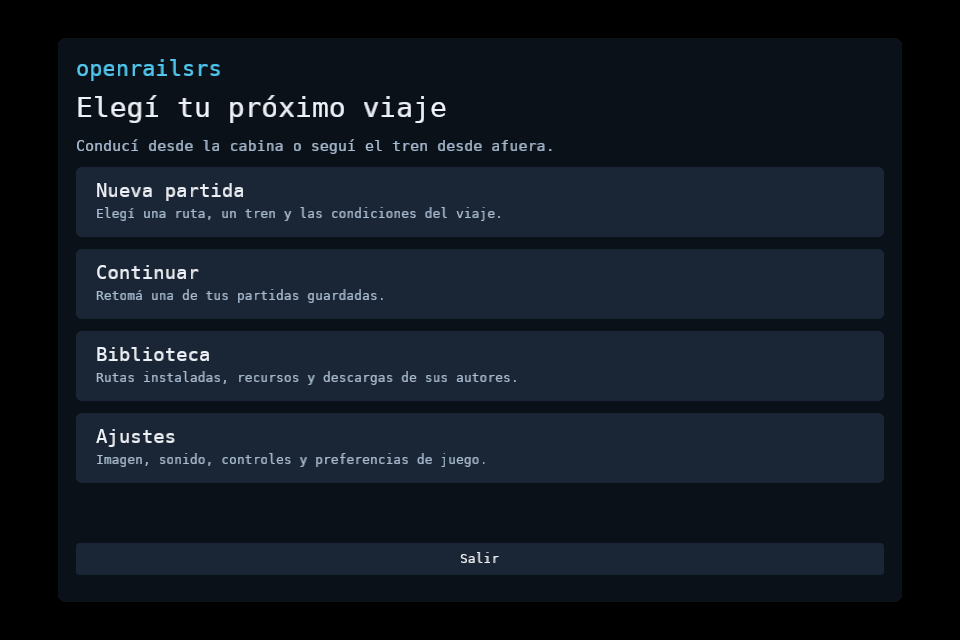

# Snap alpha.5 — revisión 6

Publicado en [latest/edge](https://snapcraft.io/openrailsrs) para Linux amd64,
con base core24 y confinamiento estricto. Incluye las entregas recientes de
equipos de vehículos, frenos, cabinas, puertas, peralte, clima e iluminación.
Los [treinta cambios más recientes](../../../PLAYER_30_4_MANUAL.md) tienen
ejemplos y pasos de prueba individuales.

La compilación utilizó el commit `979d9596141baeb8723b2f695babfe8a9eef3090`.
Los 1.545 archivos de entrada y 301 recursos distribuidos coinciden con sus
hashes. Los binarios requieren glibc 2.39, disponible en core24. Pasaron las
15 pruebas de empaquetado y toda la CI del commit. La auditoría de archivos
propios no encontró rutas personales, credenciales ni datos del jugador.
Las rutas descargadas siguen fuera del paquete.

La actualización de la instalación de prueba conservó su dato común. Con
usuario sin privilegios y Snap estricto pasaron HTTPS, la CLI de dos motores
nativos y mercancías, el menú y ocho capturas de equipos y clima. Todos los
pipelines terminaron listos y sin errores. Eventos de teclado X11 comprobaron
que L cambia a la cabina secundaria y O baja los pantógrafos y corta el contacto.
La compilación publicada no habilita la inyección de acciones de `dev-tools`.

Las capturas usan Xvfb y Vulkan por software, con los ejemplos propios de colores.
El contenido nativo y la GPU física se validaron por separado antes de empaquetar.
Esta prueba no certifica una escucha humana ni un recorrido original completo
dentro del Snap. Los cuatro issues anteriores de escucha siguen abiertos.

El paquete descargado de Snap Store coincide byte por byte con el probado:
164.024.320 bytes, SHA-256
`90406cf3cb4fd160e8b4d3c6952f6eb956d15c1eeff7e3ede93a20bfe7e65f12`.
[Recibo de publicación](release.json), [resumen de QA](verification.json) y
[hashes de fuentes](source-sha256.json).

Para actualizar, cerrá el visor y ejecutá:

```bash
sudo snap refresh openrailsrs --edge
snap run openrailsrs
```


