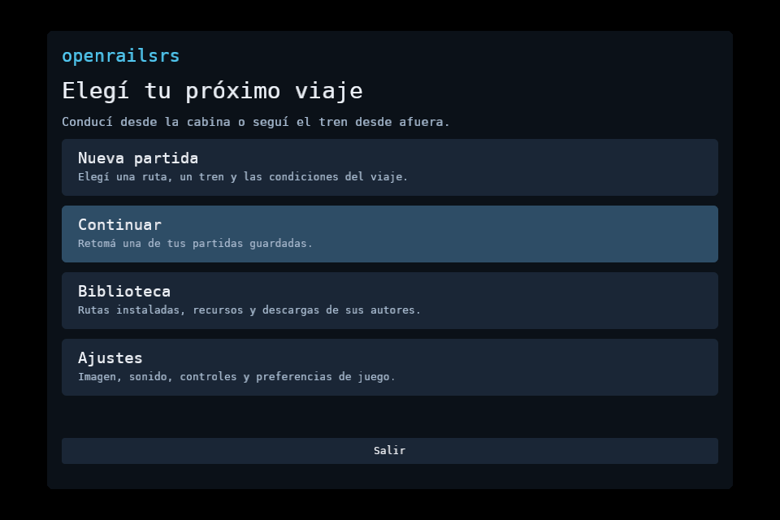
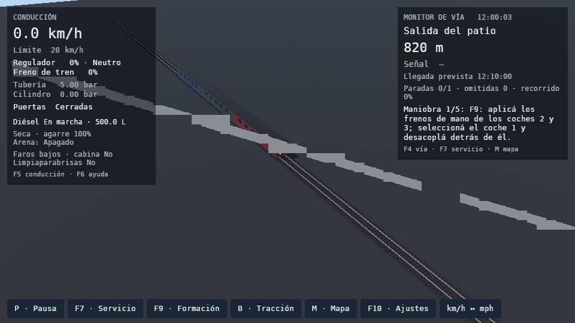

# Operación del tren y alpha: comprobaciones del 11 de octubre

Registro del [issue #208](https://github.com/cavazquez/openrailsrs/issues/208).
La [guía de los diez objetivos](../../../TRAIN_OPERATION_UPDATE.md) explica
los controles y qué observar en una partida. `results.json` conserva métricas
seleccionadas sin rutas personales, partidas ni contenido descargado.

## Pruebas del código

`check.sh` comprueba formato, Clippy con `-D warnings`, pruebas del workspace,
Python, web, distribución y los oráculos fijados en Open Rails 1.6.1,
commit `d16e670da333d26d2edfc97d5631a19dadf49ce5`. El registro final contiene
1.750 pruebas Rust y 88 Python aprobadas.

Los seis casos de `ten_goals.rs` ejercitan independiente/emergencia, depósito,
cargas de pasajeros, protección térmica, vapor hacia adelante y atrás y una
maniobra completa con guardado/reanudación. Una prueba de Bevy adicional carga
el patio real, verifica dimensiones de sus tres vehículos, asegura/desacopla
la cola y mueve la locomotora: ambos vagones conservan su posición visual.

El oráculo térmico añade 200 puntos y 8.000 entradas RPM/carga obtenidas de las
DLL originales para cuatro modos de refrigeración. Exige menos de 0,01 °C de
error y el mismo estado de refrigeración. Los oráculos existentes mantienen
sus tolerancias: el servicio Chiltern da RMS 0,2081 m/s y máximo 39,61 m de
odómetro; Class 47 da RMS 0,2382 m/s y máximo 25,79 m.

## Viaje y clima

Se completó el servicio original de tres estaciones a tiempo ×1, con un
Pullman de ocho coches, 2 km de escenario y cinco condiciones meteorológicas.
Equipo de prueba: RX 7600/RADV, 1280 × 720, sin audio. La comparación principal
usa una ejecución de la base y una del binario final del commit `a0af50c`,
sin compilación concurrente durante el viaje final.

- P99 durante la marcha: 48 ms en la base y 45 ms en el binario final.
- Cuadros de más de 100 ms durante la marcha: tres y cinco respectivamente;
  el mayor pasó de 137 a 131 ms. No demuestra una mejora estable de esos picos.
- Pico RSS: 2.173 MiB y 2.350 MiB. No demuestra reducción de memoria.
- Las tres paradas se completaron, con errores de posición de 0,00, 2,67 y
  3,02 m, sin errores SIGSCR ni pipelines fallidos.
- La carga inicial se cuenta por separado; conserva picos de aproximadamente
  1,8 s. Una forma individual grande todavía puede producir un pico.

Una primera ejecución del candidato coincidió con compilaciones y se repitió
sin ellas. Esa medición intermedia dio P99 de 44 ms, dos cuadros sobre 100 ms
y 2.390 MiB; también se conserva en `results.json`, identificada por hash.
El viaje final se repitió después de corregir los vehículos sintéticos y
de explicitar las capas del sol. Las colas reducen trabajo por cuadro, pero
estas muestras no permiten prometer ausencia de tirones en cualquier equipo.

En Paddington v4 se probaron lluvia y nevada intensas, con ocho coches originales
y 8.192 partículas Hanabi. Además de las capturas en pausa, se recorrieron 50 m
a tiempo ×1 en cada clima. Ambas pruebas en movimiento tuvieron P99 de 26 ms y
cero cuadros de más de 100 ms durante la marcha. El error máximo entre centros
de coches fue 0,027 m. Un cuadro de render puede caer entre dos ticks físicos y
tener delta de partículas cero; las comprobaciones usan el tramo en movimiento.

## Tráfico y audio

En Chiltern clásico, con el Pullman original en los tres servicios y reloj ×4,
el jugador completó tres paradas, el adelantado dos y el contrario una. Ambos
servicios AI llegaron y se detuvieron. No hubo paradas propias omitidas ni
errores SIGSCR. Se observaron seis emisores originales con Hanabi. La prueba
de ocupación también exige una señal roja hasta que la formación libere el bloque.
Este itinerario no se presenta como validado de principio a fin en Chiltern v4.

La mezcla offline del Pullman pasó en cabina y exterior: 69 muestras, ningún
WAV faltante ni clipping. Las pruebas del mezclador comprueban balance continuo,
Doppler y las excepciones de interiores, Ignore3D y estéreo del autor. No es
una comparación acústica completa con el renderer de sonido de Open Rails.

## Snap estricto

El paquete se construyó en Ubuntu 24.04/core24, amd64. La prueba utiliza un
usuario sin privilegios en una instancia LXD con AppArmor/seccomp estrictos,
X11 virtual y Vulkan por software. Comprueba CLI, HTTPS con certificados,
menú, recursos de los tres ejemplos nuevos, patio y lluvia/nieve CPU.

**0.1.0-alpha.3**, revisión **3**, se publicó el **11 de octubre de 2026** en
**latest/edge** de [Snap Store](https://snapcraft.io/openrailsrs).
Mide 159.780.864 bytes; SHA-256
`6fb1e19e239c2063c74456261a5add7b1e1de0f82bccd93b3bcccffbc6ab7e36`.
La descarga posterior de la revisión 3 desde edge conserva tamaño y hash.
La copia compilada coincide con 51 archivos de fuentes, receta y lanzador
auditados. El manifiesto de recursos tiene 218 entradas previamente versionadas.

También abre una salida PulseAudio real hacia un sumidero silencioso de QA y
activa el limpiaparabrisas: dispositivo disponible, voz activa y ningún aviso.
La biblioteca privada `libpulsecommon` necesita el directorio `pulseaudio/`
en la búsqueda del lanzador. La prueba inicial detectó esa omisión y se repitió
con el paquete reconstruido. Esto no reemplaza escuchar con parlantes/auriculares.

Las capturas siguientes pertenecen al paquete final. El patio es un ejemplo
de operaciones con geometría sintética básica, sin escenario original.

El hash, tamaño, estado de pruebas y revisión publicada se registran en
`results.json`. Las descargas de Biblioteca, perfiles y partidas quedan fuera
del paquete; el manifiesto conserva los recursos previamente versionados.

## Alcance

Estas pruebas certifican los ejemplos y casos indicados. El circuito neumático,
la conservación de caldera y la protección térmica optativa tienen el alcance
descrito en la guía; no declaran equivalencia de todos los sistemas de OR.
Las medidas GPU se hicieron fuera del Snap. Su prueba estricta por software
no certifica GPU física, Wayland, todas las rutas ni todos los controladores.
